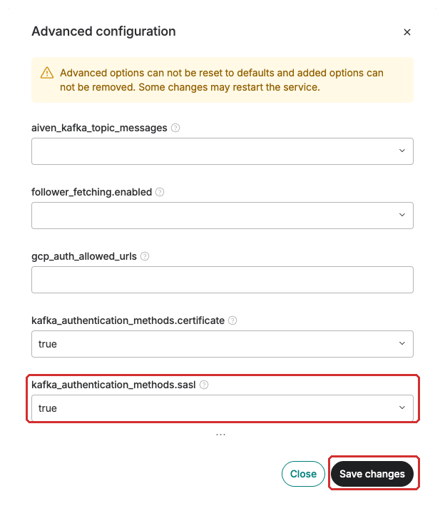
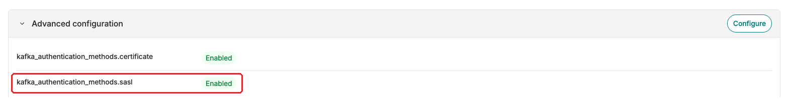
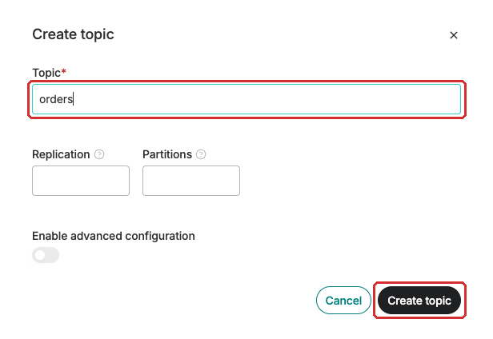
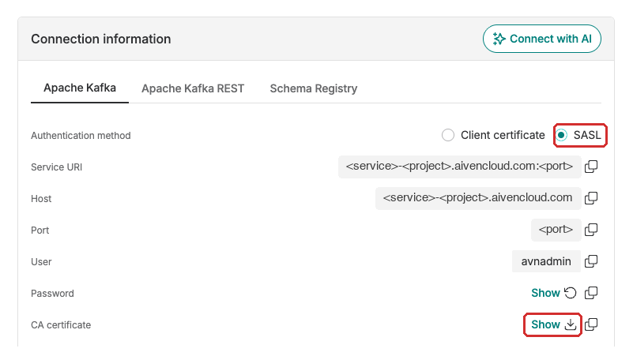

# Week 10 — Preparation before class

[All preparation checklists](README.md) · [Module homepage](../README.md)

In Week 10, you will build an incremental pipeline on **Databricks Free Edition**, the same workspace as in
Week 8. At the end, the pipeline reads order events from a Kafka topic, so you also need a small Kafka broker
of your own on **Aiven**. You only need a web browser; nothing is installed and no data needs to be downloaded.

## 1. Sign in

Open your workspace (`https://dbc-….cloud.databricks.com/`) and sign in. No account yet? Follow
[1. Create your account](week-08.md#1-create-your-account) from Week 8.

## 2. Update the Git folder

If you added the course repository as a Git folder in Week 8, open it, click the branch name → **Pull**.
You should then see the folder `weeks/10-structured-streaming-incremental`.

No Git folder yet? That's fine, we set it up together at the start of the practical.

## 3. Check that it works

In **SQL Editor**, run:

```sql
SELECT current_user(), current_catalog();
```

You should see your email. The first query may take up to a minute.

## 4. Create a free Kafka service on Aiven

Aiven runs Apache Kafka for you. The free tier is enough for this course, and you don't need a credit card.

1. Sign up at [console.aiven.io/signup](https://console.aiven.io/signup). Your HSLU email is fine.
2. Go to **Services** → **Create service** → **Aiven for Apache Kafka**.
3. Choose the service tier **Free** and the region group **Europe**, give the service a name (e.g.
   `deng-kafka`) and click **Create service**.
4. Wait until the status says **Running**. This takes a few minutes.

## 5. Prepare the connection

Databricks logs in to your Kafka service with a user name and password (SASL) and checks the server with
Aiven's certificate. Both need a few clicks in the Aiven Console, best done now while the service is running.

**Turn on SASL.** A new service only accepts client certificates.

1. Open your service → **Service settings** (left menu, at the bottom)
2. Scroll down to **Advanced configuration** → **Configure**
3. Find `kafka_authentication_methods.sasl`, choose `true`, then **Save changes**. Leave everything else as it is



The service may restart; wait until it says **Running** again. Under **Advanced configuration** you
now see:



**Create the topic.** **Topics** (left menu) → **Create topic**, name `orders`, leave replication and
partitions empty (the free tier allows up to 5 topics with 2 partitions each) → **Create topic**.



**Download the certificate.** **Overview** → box **Connection information** → tab **Apache Kafka**,
authentication method **SASL**. Click the download arrow next to **CA certificate**: you get `ca.pem`.



| Field | What it is | You need it |
|---|---|---|
| Host, Port | where the broker is. The SASL port is not the same as the client-certificate port, so copy it with SASL selected | in class |
| User | `avnadmin` | in class |
| Password | **Show** reveals it, the copy icon copies it | in class, typed into a widget, never into your code |
| CA certificate | download arrow → `ca.pem` | keep the file, you upload it to Databricks in class |

Don't see the **SASL** option? Then step «Turn on SASL» isn't saved yet, or the service is still rebuilding
after the change. Wait until it says **Running** and reload the page.

`ca.pem` is not a secret: it's Aiven's public certificate, so the Kafka client knows it talks to your real
broker. The password is the secret. In class, it goes into a Databricks secret scope.

## 6. On the day of the class

A free service powers off when nobody uses it (after about 24 hours, sometimes earlier), so yours will
probably be off on the day of the class. That's fine: open the service, choose **Power on service** in the service menu (the three dots)
at the start of the lesson, and it's back after about five minutes.

More about the free tier: [Aiven for Apache Kafka free tier](https://aiven.io/docs/products/kafka/free-tier/kafka-free-tier)

Do not run the Week 10 notebooks yet.
