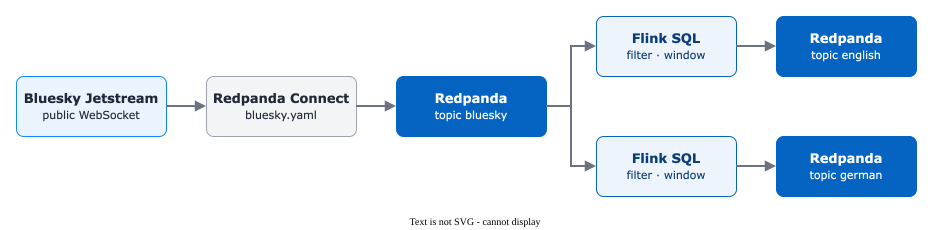

# Flink SQL on the Bluesky Firehose

> **A fresh start.** This exercise does not build on the Python exercises
> 01–06: it uses a new data source, the live Bluesky stream, and a new tool,
> Dinky. Everything you need is set up in steps S1–S6 below. Inside this
> exercise the tasks are called A–G, the setup steps S1–S6.

## Background

[Bluesky](https://bsky.app) is a decentralised social network similar to
X/Twitter. Every public post is published in real time over a free,
unauthenticated WebSocket API called **Jetstream** — no API key, no rate
limit. That makes it an ideal data source for learning stream processing:
real, messy, multilingual data flowing at ~50–100 events/second.

In this track you'll:

1. Pipe the live Bluesky firehose into a Redpanda topic.
2. Define a Flink SQL table over that topic.
3. Run streaming queries that filter, window and aggregate posts.
4. Write transformed results back to new Redpanda topics.

### Architecture



> **Slots are limited (4 total).** Each running query (`SELECT` or
> `INSERT INTO`) uses one slot. Stop unused jobs with the red ■ button
> before starting new ones.

---

## Setup

### How the posts get to you

Before you write a single query, look at the path a post takes — four
stations, and you set up each of them in the steps below:

| Station | What it is | Step |
|---|---|---|
| **Bluesky Jetstream** | Bluesky's public WebSocket: every new post worldwide is pushed out the moment it is written | — (runs on the internet) |
| **Redpanda Connect** | a small program in your Codespace that listens to the WebSocket, keeps a few fields of each post and writes it as **one event** into Redpanda | S1 |
| **Topic `bluesky`** | where the posts pile up in Redpanda, one event per post | S2 |
| **Table `bluesky_posts`** | a Flink SQL table *over* the topic: it stores nothing itself, Flink reads the topic whenever a query runs | S4, S5 |

Your queries (S6, tasks A–G) read from `bluesky_posts` and write their
results into new topics.

Do steps S1–S6 once. After that, every task re-uses the `bluesky_posts`
table without re-creating it.

### S1 — Pull the posts in: start Redpanda Connect

Nothing arrives by itself — you have to switch the feed on. In a VS Code
terminal, from the repository root (where a new terminal starts):

```bash
docker compose -f streaming/docker-compose.yml --profile bluesky up -d redpanda-connect
```

This starts **Redpanda Connect**. Its recipe is
[`streaming/connect/bluesky.yaml`](../../../streaming/connect/bluesky.yaml):
connect to the Jetstream WebSocket, take each new post, keep a handful of
fields and write it to the topic `bluesky`.

**Check:** in the same terminal run

```bash
docker compose -f streaming/docker-compose.yml ps redpanda-connect
```

The service must show `running`. Then go on to S2 and look at the posts.

Redpanda Connect keeps running in the background until you stop it (at the
end, see *Cleanup*):

```bash
docker compose -f streaming/docker-compose.yml --profile bluesky stop redpanda-connect
```

### S2 — Look at the posts in Redpanda Console

Open **Redpanda Console** (port `8080` in the *PORTS* tab) → *Topics* →
`bluesky`. New messages arrive every second. Click on one to open it. It
looks like this (shortened):

```json
{
  "did": "did:plc:4f2k…",
  "text": "Guten Morgen aus Luzern!",
  "langs": ["de"],
  "created_at": "2026-11-12T08:15:02.120Z",
  "is_reply": false,
  "timestamp": "2026-11-12T08:15:02.481Z"
}
```

| Field | Meaning |
|---|---|
| `did` | the author's account id (anonymous-looking, but public) |
| `text` | the text of the post |
| `langs` | the **language tags** of the post — a list, e.g. `["de"]` or `["en", "de"]`. The Bluesky app sets them when the post is written (from the phone's language or chosen by the author). Sometimes the list is empty. |
| `created_at` | when the author wrote the post |
| `is_reply` | `true` if the post answers another post |
| `timestamp` | when Redpanda Connect received it |

`langs` is the field you will filter on: German posts are the ones with
`de` in the list.

### S3 — Register the Flink cluster in Dinky (once per Codespace)

If you have not done it yet: follow the
[Dinky guide](../01_setup/dinky_guide.md) — own password, cluster `deng`
(`flink-jobmanager:8081`, type `Standalone`), a folder and a first task.

### S4 — Create the source table

In Dinky → Data Studio → new FlinkSQL task.

> ⚠️ **For every new task** in this track, set in the right-hand panel:
>
> - **Cluster Configuration / Flink Instance** → `deng`
> - **Catalog** → `DefaultCatalog`
>
> Without `DefaultCatalog` your table is invisible to other tasks. Without
> `deng` the SQL runs in Dinky's local mini-cluster, which has no Kafka
> connector and your `INSERT INTO` will fail with cryptic errors.

This statement tells Flink: «there is a topic `bluesky` with JSON posts;
show it to me as a table with these columns». It copies nothing. Flink
reads the topic only when a query uses the table. `'scan.startup.mode' =
'latest-offset'` means: start with the posts that arrive *from now on*.

Run this **once**:

```sql
-- DROP TABLE IF EXISTS bluesky_posts;
CREATE TABLE IF NOT EXISTS bluesky_posts (
    did          STRING,
    time_us      BIGINT,
    operation    STRING,
    `text`       STRING,
    created_at   STRING,
    langs        ARRAY<STRING>,
    reply_parent STRING,
    reply_root   STRING,
    is_reply     BOOLEAN,
    embed        STRING,
    facets       STRING,
    `timestamp`  STRING,
    proc_time AS PROCTIME()
) WITH (
    'connector' = 'kafka',
    'topic' = 'bluesky',
    'properties.bootstrap.servers' = 'redpanda:29092',
    'scan.startup.mode' = 'latest-offset',
    'format' = 'json',
    'json.fail-on-missing-field' = 'false',
    'json.ignore-parse-errors' = 'true'
);
```

**Check:** Dinky reports success at the bottom. Run `SHOW TABLES;` in the
same task: `bluesky_posts` must be in the list.

> **Why `proc_time AS PROCTIME()`?** Window functions need a time
> attribute. `PROCTIME()` is the cluster's wall clock when each record
> is processed. Simpler than event-time + watermarks for these
> exercises.

### S5 — First sanity-check query

In a new task, run this with the red 🐞 **Search** button (`Shift+F9`), not
with ▶ *Execute* — only *Search* shows the rows in the **Result** tab
(see the [Dinky guide](../01_setup/dinky_guide.md), step 3):

```sql
SELECT `text`, langs, is_reply, created_at FROM bluesky_posts;
```

Posts appear in the **Result** tab as they arrive. Look at the column
`langs`: you see `[en]`, `[ja]`, `[pt]`, `[de]` … — the language tags from
S2. Stop the job (red ■) when you've seen enough — it occupies a slot.

### S6 — Tutorial: filter English posts to a new topic

This is the canonical pattern (filter → write back to Kafka) and the
basis for most tasks: keep only the English posts and write them into a
new topic `bluesky-english`.

- `CREATE TABLE bluesky_english …` creates the **sink**: a table whose
  rows are written into the topic `bluesky-english`.
- `INSERT INTO bluesky_english SELECT … FROM bluesky_posts WHERE langs[1] = 'en'`
  reads every new post, keeps it if its **first** language tag is `en`
  (`langs[1]` — SQL arrays start at 1) and writes it into the sink.

Do it in a new task, one step at a time.

**Step 1 — create the sink.** Run only this statement:

```sql
-- DROP TABLE IF EXISTS bluesky_english;
CREATE TABLE IF NOT EXISTS bluesky_english (
    did STRING,
    `text` STRING,
    created_at STRING,
    is_reply BOOLEAN,
    `timestamp` STRING
) WITH (
    'connector' = 'kafka',
    'topic' = 'bluesky-english',
    'properties.bootstrap.servers' = 'redpanda:29092',
    'format' = 'json'
);
```

**Check:** `SHOW TABLES;` now lists `bluesky_english` as well. The topic
`bluesky-english` does not exist yet — it is created when the first row
is written in step 2.

**Step 2 — start the streaming job.** Replace the statement in the editor
with this one and run it:

```sql
INSERT INTO bluesky_english
SELECT did, `text`, created_at, is_reply, `timestamp`
FROM bluesky_posts
WHERE langs[1] = 'en';
```

`INSERT INTO` is a **continuous streaming job** — it runs until you stop
it.

**Check:**

1. **Flink UI** (port `8081`) → *Running Jobs*: a new job with status
   `RUNNING` (Dinky names it after your task).
2. **Redpanda Console** → *Topics*: the new topic `bluesky-english` has
   appeared. Open a message — it is an English post.

Then stop the job (red ■ in Dinky) — it occupies one of the 4 slots.

---

## Task A — filter German posts to a new topic

**Goal:** every German post from the firehose lands in its own topic
`bluesky-german` — continuously, as long as the job runs.

«German» means: the post's **first language tag** is `de` — the field
`langs` you looked at in setup step S2, so the filter is `langs[1] = 'de'`.

**What you do:** the same as in setup step S6 above (English posts), only for German (`'de'` instead of
`'en'`). It takes two statements in a Dinky task:

1. **Create the sink.** A *sink* is a Flink table that holds no data
   itself — everything you insert into it is written to a Kafka topic.
   Here: table `bluesky_german` → topic `bluesky-german`. The statement
   is given below; copy it and run it once.
2. **Start the streaming job.** An `INSERT INTO … SELECT … FROM
   bluesky_posts WHERE …` reads the firehose, keeps only the German
   posts and writes them into the sink. This one you write yourself,
   with setup step S6 as the template: same columns, different table and language.

### Step 1 — create the sink (copy and run once)

```sql
CREATE TABLE IF NOT EXISTS bluesky_german (
    did STRING,
    `text` STRING,
    created_at STRING,
    is_reply BOOLEAN,
    `timestamp` STRING
) WITH (
    'connector' = 'kafka',
    'topic' = 'bluesky-german',
    'properties.bootstrap.servers' = 'redpanda:29092',
    'format' = 'json'
);
```

**Check:** `SHOW TABLES;` lists `bluesky_german`.

### Step 2 — write the streaming job

Write the `INSERT INTO` statement and run it. It keeps running — stop it
later with the red ■.

```sql
-- TODO: INSERT INTO bluesky_german  ...  FROM bluesky_posts WHERE langs[1] = 'de';
```

### Check

1. **Flink UI** (port `8081`) → *Running Jobs*: your job is `RUNNING`.
2. **Redpanda Console** → topic `bluesky-german`: German posts arrive
   within seconds. Open one and read it.

Stop the job (red ■) before the next task.

**Questions**

- Why is there much less traffic than in `bluesky_english`?
- What does `langs[1]` mean in Flink SQL? (Hint: SQL arrays are 1-indexed.)

---

## Task B — tumbling window: posts per language (2 min)

**Goal:** count how many posts arrive in **English (`en`), German (`de`),
French (`fr`), Italian (`it`)** every 2 minutes. Write the per-window
counts to a Kafka topic.

### Step 1 — create the sink (Dinky, once)

```sql
CREATE TABLE IF NOT EXISTS language_counts (
    lang STRING,
    window_start TIMESTAMP(3),
    window_end TIMESTAMP(3),
    post_count BIGINT
) WITH (
    'connector' = 'kafka',
    'topic' = 'language-counts',
    'properties.bootstrap.servers' = 'redpanda:29092',
    'scan.startup.mode' = 'earliest-offset',
    'format' = 'json'
);
```

### Step 2 — write the streaming job

Hints:
- `TUMBLE_START(proc_time, INTERVAL '2' MINUTES) AS window_start`
- `TUMBLE_END(proc_time,   INTERVAL '2' MINUTES) AS window_end`
- `WHERE langs[1] IN ('en', 'de', 'fr', 'it')`
- `GROUP BY langs[1], TUMBLE(proc_time, INTERVAL '2' MINUTES)`

```sql
-- TODO: INSERT INTO language_counts SELECT ... FROM bluesky_posts ...
```

### Verify

Stop the `INSERT` job (you need the slot) and run in a new task:

```sql
SELECT * FROM language_counts;
```

> **Tumbling window**
> Splits the stream into fixed, non-overlapping intervals. Every event
> belongs to exactly one window.
> ```
> |--- Window 1 ---|--- Window 2 ---|--- Window 3 ---|
> 00:00          02:00            04:00            06:00
> ```

**Questions**

- How many rows per 2-minute window do you get? Why?
- Which language dominates?
- What changes if the interval is `1` minute?

---

## Task C — tumbling window: total posts (3 min)

**Goal:** count all posts every 3 minutes, regardless of language.

### Step 1 — sink (once)

```sql
CREATE TABLE IF NOT EXISTS post_counts_3min (
    window_start TIMESTAMP(3),
    window_end TIMESTAMP(3),
    total_posts BIGINT
) WITH (
    'connector' = 'kafka',
    'topic' = 'post-counts-3min',
    'properties.bootstrap.servers' = 'redpanda:29092',
    'scan.startup.mode' = 'earliest-offset',
    'format' = 'json'
);
```

### Step 2 — streaming job

Hints: no `WHERE` needed; `GROUP BY TUMBLE(proc_time, INTERVAL '3' MINUTES)`.

```sql
-- TODO: INSERT INTO post_counts_3min SELECT ... FROM bluesky_posts ...
```

**Questions**

- How many posts arrive in 3 minutes? Does the rate vary over time?
- Why exactly 1 row per window (compared to Task B)?

---

## Task D — sliding (hopping) window: language trends

**Goal:** track each language with a **10-minute** wide window that **slides
every 2 minutes** — a smoother trend curve than tumbling.

### Step 1 — sink (once)

```sql
CREATE TABLE IF NOT EXISTS language_trends (
    lang STRING,
    window_start TIMESTAMP(3),
    window_end TIMESTAMP(3),
    post_count BIGINT
) WITH (
    'connector' = 'kafka',
    'topic' = 'language-trends',
    'properties.bootstrap.servers' = 'redpanda:29092',
    'scan.startup.mode' = 'earliest-offset',
    'format' = 'json'
);
```

### Step 2 — streaming job

Hints — `HOP()` takes **slide first, then size**:
- `HOP_START(proc_time, INTERVAL '2' MINUTES, INTERVAL '10' MINUTES)`
- `HOP_END(proc_time,   INTERVAL '2' MINUTES, INTERVAL '10' MINUTES)`
- `GROUP BY langs[1], HOP(proc_time, INTERVAL '2' MINUTES, INTERVAL '10' MINUTES)`

```sql
-- TODO: INSERT INTO language_trends SELECT ... FROM bluesky_posts ...
```

> **Hopping (sliding) window**
> Fixed size, but overlaps. Each event belongs to **multiple** windows.
> ```
> |---------- W1 (10 min) ----------|
>       |---------- W2 (10 min) ----------|
>             |---------- W3 (10 min) ----------|
>   slide: 2 min
> ```
> With size 10 and slide 2, each event is counted in 5 windows.

**Questions**

- How does the output rate compare to Task B?
- Why do consecutive windows overlap?
- How many windows does a single event belong to? (size / slide)

---

## Task E — session window: per-user activity bursts

**Goal:** group posts per user (`did`) into **sessions**: a session ends when
the user is silent for 60 seconds.

### Step 1 — sink (once)

```sql
CREATE TABLE IF NOT EXISTS user_sessions (
    did STRING,
    session_start TIMESTAMP(3),
    session_end TIMESTAMP(3),
    post_count BIGINT
) WITH (
    'connector' = 'kafka',
    'topic' = 'user-sessions',
    'properties.bootstrap.servers' = 'redpanda:29092',
    'scan.startup.mode' = 'earliest-offset',
    'format' = 'json'
);
```

### Step 2 — streaming job

Hints:
- `SESSION_START(proc_time, INTERVAL '60' SECONDS)`
- `SESSION_END(proc_time,   INTERVAL '60' SECONDS)`
- `GROUP BY did, SESSION(proc_time, INTERVAL '60' SECONDS)`

```sql
-- TODO: INSERT INTO user_sessions SELECT ... FROM bluesky_posts ...
```

> **Session window**
> Defined by a **gap of inactivity**, not a fixed size. As long as events
> keep coming within the gap, the window grows. After the gap it closes.
> ```
> User A: |-post--post-post----post-|   (gap > 60 s)   |--post--post--|
>              Session 1 (4 posts)                     Session 2 (2 posts)
> ```

**Questions**

- What's the longest session you find?
- How does the gap duration change the session count?

---

## Task F — reply rate per 5-minute window

**Goal:** for each 5-minute tumbling window, compute the percentage of posts
that are replies (`is_reply = TRUE`). No sink — just a `SELECT` to look at.

Hints:
- `SUM(CASE WHEN is_reply THEN 1 ELSE 0 END)` to count replies
- `CAST(... AS DOUBLE) / COUNT(*) * 100` to get a percentage
- `GROUP BY TUMBLE(proc_time, INTERVAL '5' MINUTES)`

```sql
-- TODO: SELECT window_start, total_posts, replies, reply_pct FROM ...
```

**Questions**

- What share of Bluesky posts are replies?
- Does the share drift over time?

---

## Task G — bonus: see your own post arrive

**Goal:** filter the firehose for the keyword `HSLU_Flink`, post that string from
your own Bluesky account, and watch it appear in your Flink output within
seconds.

### Step 1 — sink (once)

```sql
CREATE TABLE IF NOT EXISTS deng_post_table (
    did STRING,
    `text` STRING,
    created_at STRING,
    `timestamp` STRING
) WITH (
    'connector' = 'kafka',
    'topic' = 'deng-post',
    'properties.bootstrap.servers' = 'redpanda:29092',
    'scan.startup.mode' = 'earliest-offset',
    'format' = 'json'
);
```

### Step 2 — filter job

Hints:
- `WHERE \`text\` LIKE '%HSLU_Flink%'`

```sql
-- TODO: INSERT INTO deng_post_table SELECT ... FROM bluesky_posts WHERE ...
```

### Step 3 — observe

In a new task (after stopping the INSERT to free a slot):

```sql
SELECT * FROM deng_post_table;
```

### Step 4 — post on Bluesky

1. If you don't have an account, create one at <https://bsky.app>.
2. Write a post containing the literal string `HSLU_Flink`. Example:
   > Testing stream processing for **HSLU_Flink** — hello from Flink!
3. Re-start the `INSERT` job, then `SELECT` again. Your post should appear
   within seconds. The topic `deng-post` in Redpanda Console will also
   contain it.

**Questions**

- How long from posting to seeing it in Dinky?
- Trace the path of the message: WebSocket → ? → ? → ? → your screen.

---

## Cleanup

When you're done, stop all running Flink jobs (red ■ in Dinky) and stop
the Bluesky firehose so it doesn't fill your disk:

```bash
docker compose -f streaming/docker-compose.yml --profile bluesky stop redpanda-connect
```
