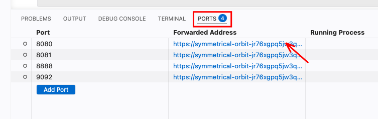

# Week 9 — Event streaming with Kafka and Flink

[Module homepage](../../README.md)

## Goal

Work hands-on with the food-delivery story from the lecture: Anna orders a pizza, a rider picks it up, and the live map shows where every rider is. You write the rider's GPS pings and Anna's order into a Kafka-compatible broker (Redpanda), read them back, aggregate them, and finally run Flink SQL on a real live stream (the Bluesky firehose) and on your own delivery data. By the end of the practical, you should be able to:

- explain what a topic, a key, a partition and an offset are, and why the key decides the order of events;
- create a topic with `rpk` and replay old events by resetting a consumer group's offset;
- write a producer that sends events and confirms their delivery;
- write a consumer that polls a topic, and explain how a consumer group remembers its position;
- distinguish at-least-once from at-most-once processing and commit offsets manually;
- maintain a running aggregate per key and flag anomalies in a stream;
- write Flink SQL queries with tumbling, hopping and session windows;
- explain event time, watermarks and what happens to late events; and
- enrich a stream with a table and join two streams within a time interval.

## Before you start

Nothing is installed on your laptop: everything runs in **GitHub Codespaces**, a development computer in the browser.

> **Sign in to GitHub with your private account.** The Codespace runs on the free monthly quota of the account you are signed in with. Check the avatar at the top right of github.com before you click *Create codespace*. The free quota lasts about 30 hours with the 4-core machine this course uses.

## 1. Open the Codespace

1. On the GitHub page of this repository, click the green **Code** button.
2. Choose the **Codespaces** tab → **Create codespace on main**.
3. Wait 3–5 minutes the first time. You'll see Visual Studio Code in your browser. Later starts are much faster.

When the Codespace is ready, four programs are already running inside it:

| Program | Where | What it does |
|---|---|---|
| **Redpanda** | no UI, port `9092` | The "post office" — stores streams of messages (topics). It speaks the Kafka protocol. |
| **Redpanda Console** | port **`8080`** | Web page to look inside topics and read messages |
| **Flink** | port **`8081`** | The "calculator" — runs queries on streaming data |
| **Dinky** | port **`8888`** | Web page to write SQL queries and send them to Flink |

A fifth program, **Redpanda Connect**, is started on demand for the Flink track. The exercise tells you when.

> **Stop the Codespace when you are done.** Closing the browser tab does *not* stop it. Go to [github.com/codespaces](https://github.com/codespaces) and click *Stop* on yours, otherwise your free hours run out.

## 2. Open the web pages

At the bottom of VS Code, click the **PORTS** tab. You'll see a list:

| Port | Label | Open it for |
|---|---|---|
| 8080 | Redpanda Console | the message viewer |
| 8081 | Flink Web UI | Flink's status page |
| 8888 | Dinky | the SQL editor |

Hover over a row → click the small **globe icon** ("Open in Browser") or the **magnifier icon** ("Preview in Editor"). Both work.



## 3. Run the smoke test

Open [01_setup/smoke_test.ipynb](01_setup/smoke_test.ipynb), select the kernel that ends in `streaming/.venv/bin/python` and run all cells. If everything prints **OK**, you're ready for the exercises. The smoke test also creates the two topics of the exercises, `rider-locations` and `orders`.

Detailed walk-through and troubleshooting: [01_setup/README.md](01_setup/README.md).

## 4. Tell Dinky where Flink lives (only for the Flink track)

You can skip this until you start the Flink track ([03_exercise/exercise_07_flink.md](03_exercise/exercise_07_flink.md), [08](03_exercise/exercise_08_flink_food.md), [09](03_exercise/exercise_09_flink_joins.md)).

1. Open **Dinky** (port `8888` in *PORTS*). On first login pick any password.
2. Top menu: **Registration Center** → side menu: **Cluster** → **Cluster Instance** (⚠️ *not* "Cluster Config" — that's for Yarn).
3. Click **+ Add**. A *Create Cluster Instance* dialog opens. Fill in:

   | Field | Value |
   |---|---|
   | **Name** | `deng` (any short name) |
   | **Alias** | `deng` (or blank) |
   | **Type** | **`Standalone`** |
   | **JobManager HA Address** | `flink-jobmanager:8081` |
   | **Note** | blank |

   The address must be `flink-jobmanager:8081` — that's the Docker service name. **Don't use `localhost`** — Dinky runs inside its own container and would only see itself.

4. Click **Save**. The instance should appear with a green **Normal** status indicator.

> ⚠️ **Whenever you create a new FlinkSQL task** (Data Studio → +), set in the right-hand panel:
>
> - **Cluster Configuration** → `deng`
> - **Catalog** → `DefaultCatalog`
>
> Both are required. The catalog makes `CREATE TABLE` definitions visible across all tasks; the cluster sends jobs to the real Flink with the Kafka connector instead of Dinky's tiny built-in mini-cluster.

Full walkthrough: [01_setup/dinky_guide.md](01_setup/dinky_guide.md).

## 5. Work through the exercises

| Part | What you do |
|---|---|
| [02_demo/demo_produce.ipynb](02_demo/demo_produce.ipynb) | Send one GPS ping of `rider_7` — a minimal producer to use as a reference card |
| [02_demo/demo_consume.ipynb](02_demo/demo_consume.ipynb) | Read the ping back — a minimal consumer |
| [exercise_01_produce_single](03_exercise/exercise_01_produce_single.ipynb) | First producer: a rider ping and Anna's order; keys and partitions; an unreachable broker |
| [exercise_02_consume_basic](03_exercise/exercise_02_consume_basic.ipynb) | Poll loop, a live consumer, and what `group.id` does |
| [exercise_03_produce_batch](03_exercise/exercise_03_produce_batch.ipynb) | Batch producer for pings and order updates; key → partition mapping; events without a key |
| [exercise_04_consume_groups](03_exercise/exercise_04_consume_groups.ipynb) | Manual offset commits; two consumers in one group; create a topic with `rpk`; replay old events with `rpk group seek` |
| [exercise_05_produce_stream](03_exercise/exercise_05_produce_stream.ipynb) | A continuous GPS stream from several riders, bursts, and simulated GPS glitches |
| [exercise_06_consume_aggregate](03_exercise/exercise_06_consume_aggregate.ipynb) | Running statistics per rider and detection of impossible speeds |
| [exercise_07_flink.md](03_exercise/exercise_07_flink.md) | Flink SQL on the live Bluesky firehose: filter, tumbling, hopping and session windows |
| [exercise_08_flink_food.md](03_exercise/exercise_08_flink_food.md) | Flink SQL on our own delivery data with event time and watermarks: orders per minute, average speed per rider, rider shifts, and a deliberately late event |
| [exercise_09_flink_joins.md](03_exercise/exercise_09_flink_joins.md) | Flink SQL joins: enrich orders with a restaurant table; join orders and payments within 15 minutes, and find unpaid orders |

Exercises 01–06 build on each other; work them top to bottom. Exercises 08 and 09 need the producers from [examples/](examples/) running in a terminal. Open a producer and a consumer notebook **side by side** (drag a tab to the right edge of the editor) to watch events arrive in real time. More details on the two tracks: [03_exercise/README.md](03_exercise/README.md).

Every exercise has a reference solution in [04_solution/](04_solution/). Try the exercise first, then compare.

## What's where

- [01_setup/](01_setup/) — kernel selection, smoke test, Dinky guide. **Start here.**
- [02_demo/](02_demo/) — minimal working notebooks for producer and consumer
- [03_exercise/](03_exercise/) — six progressive Kafka notebooks plus the Flink SQL track (Bluesky, delivery data, joins)
- [04_solution/](04_solution/) — reference answers for every exercise
- [examples/producer.py](examples/producer.py) — Python script that simulates riders and sends their GPS pings to `rider-locations` (`--shifts`: riders take breaks, for the session windows of exercise 08)
- [examples/order_producer.py](examples/order_producer.py) — Python script that places orders with status updates (`orders`) and payments (`payments`, some never come); `--late 3` sends one order that is 3 minutes late
- [examples/consumer.py](examples/consumer.py) — Python script that prints messages from a topic
- [examples/flink_rider_locations.sql](examples/flink_rider_locations.sql) — Flink SQL: pings and speed per rider and minute
- [examples/flink_bluesky.sql](examples/flink_bluesky.sql) — Flink SQL source table for the Bluesky firehose

The environment itself lives outside this folder, because the Codespace builds it for the whole repository:

- [streaming/docker-compose.yml](../../streaming/docker-compose.yml) — defines all the running programs
- [streaming/pyproject.toml](../../streaming/pyproject.toml) — Python packages (Kafka client + notebook kernel); the venv is `streaming/.venv`
- [streaming/flink/Dockerfile](../../streaming/flink/Dockerfile) — the Flink image, with the Kafka connector pre-installed
- [streaming/dinky/Dockerfile](../../streaming/dinky/Dockerfile) — the Dinky image, with English UI and the Kafka connector
- [streaming/connect/bluesky.yaml](../../streaming/connect/bluesky.yaml) — the Redpanda Connect pipeline for the Bluesky firehose

To run the example scripts in the Codespace, open a terminal in the repository root:

```bash
uv run --project streaming weeks/09-event-streaming/examples/producer.py   # 60 s of rider pings
uv run --project streaming weeks/09-event-streaming/examples/producer.py --shifts --duration 1800   # 30 min, with breaks
uv run --project streaming weeks/09-event-streaming/examples/order_producer.py   # orders + payments, 30 min
uv run --project streaming weeks/09-event-streaming/examples/order_producer.py --late 3   # one late order
uv run --project streaming weeks/09-event-streaming/examples/consumer.py   # stop with Ctrl+C
```

## If something goes wrong

| Problem | What to do |
|---|---|
| `docker: command not found` | The Codespace was built before Docker was added. Run *Codespaces: Rebuild Container* from the command palette (`F1`). |
| `KafkaError: Broker not available` | The stack is still starting. Wait 30 s, or check with `rpk cluster info -X brokers=redpanda:29092`. |
| Notebook can't find `confluent_kafka` | Wrong kernel. *Select Kernel* → the entry ending in `streaming/.venv/bin/python`. See [01_setup/README.md](01_setup/README.md). |
| Every event lands on partition 0 | The topic was created automatically with only 1 partition. Run the smoke test again: it grows the topics to 3 partitions. |
| Dinky shows Chinese text | Clear the browser's localStorage for the Dinky tab or open it in an incognito window. The container sets English on first start, but a cached old session can override it. |
| A port shows the wrong label | Rebuild the container so the `portsAttributes` from `.devcontainer/devcontainer.json` take effect. |
| Flink job fails with "topic not found" | Create the topic first: `rpk topic create <name> -X brokers=redpanda:29092`. |

## Running locally (without Codespaces)

If you have Docker and [uv](https://docs.astral.sh/uv/) on your laptop, you can run the same stack locally. From the repository root:

```bash
docker compose -f streaming/docker-compose.yml up -d
cd streaming && uv sync && cd ..
KAFKA_BROKERS=localhost:9092 uv run --project streaming weeks/09-event-streaming/examples/producer.py
```

Open the web pages on `localhost`: <http://localhost:8080> (Console), <http://localhost:8081> (Flink), <http://localhost:8888> (Dinky).

Two differences to the Codespace:

- **Broker address in the notebooks.** The notebooks use the Docker-internal address `redpanda:29092`, which only works inside the Docker network. From your laptop the broker is at `localhost:9092`: change the line `BROKER = 'redpanda:29092'` at the top of each notebook to `BROKER = 'localhost:9092'`. Inside Flink and Dinky everything stays at `redpanda:29092` and `flink-jobmanager:8081`.
- **Kernel.** Pick `streaming/.venv/bin/python` as the kernel in VS Code or Jupyter.

Stop the stack with `docker compose -f streaming/docker-compose.yml down`. Add `-v` to also delete all topics and messages.
