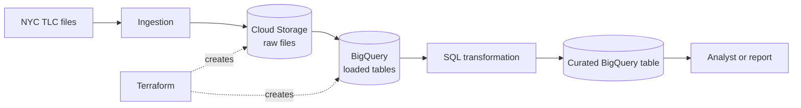

# Week 11 — Cloud platform and Terraform

[Module homepage](../../README.md) · [Downloads before class](../../preparation/week-11.md)

## Goal

Prepare the cloud infrastructure for the NYC Taxi example. By the end of the two-hour session, you should be able to:

- distinguish a data lake, data warehouse, and data mart;
- explain the difference between ETL and ELT;
- distinguish infrastructure provisioning from a data pipeline;
- read and write a small Terraform configuration;
- inspect a Terraform plan before creating resources;
- configure a service account and its permissions for Terraform;
- provision and inspect an empty Google Cloud Storage bucket and BigQuery dataset; and
- remove the exercise resources with `terraform destroy`.

Refactoring with variables (Part 4), uploading a taxi file with Kestra (Part 5), and loading it into BigQuery (Part 6) are extensions if time permits, or follow-up exercises. Part 5 can follow Part 3 directly; Part 6 builds on Part 5.

## From Week 5 to Week 11

In Week 5, Kestra coordinated tasks that downloaded, transformed, validated, and loaded taxi records into local PostgreSQL. Week 11 introduces cloud storage and a cloud analytical database.

The solid arrows show the **data pipeline**: data moves and changes. The dotted arrows show **infrastructure provisioning**: Terraform creates and configures the places where the data will live. Terraform does not replace ingestion or transformation.

This diagram shows the wider architecture. The core session covers infrastructure. Optional Part 5 adds downloading and uploading one file; Part 6 loads it into BigQuery and checks rerun behaviour. Business transformations remain follow-up work.

## Classroom practical sequence

1. [Map the local pipeline to a cloud platform](part-1-platform-map.md).
2. [Set up the Google Cloud project, billing and authentication](part-2-google-cloud-setup.md), including the Terraform service account, permissions and JSON key.
3. [Create a bucket and BigQuery dataset with Terraform](part-3-terraform.md): complete the starter, inspect plans, apply, check state, and finish by removing the exercise resources with `terraform destroy`.
4. **Optional extension:** [refactor the configuration with variables and practise a controlled change](part-4-terraform-variables.md).

5. **Optional extension:** [upload a taxi file to Cloud Storage with Kestra](part-5-kestra-to-cloud-storage.md): configure a pipeline identity, complete the upload task, verify the object and investigate a rerun.

6. **Optional extension:** [load and query taxi data in BigQuery](part-6-kestra-to-bigquery.md): add the third Kestra task, inspect the monthly staging table and verify replacement on reruns. Then add a fourth task to merge new records into the consolidated `yellow_trips` table using row hashes, and test January → February → January again to check that an unchanged rerun does not add duplicates.

Parts 1–6 are available. Parts 1–3 form the core session; Parts 4–6 are follow-up exercises. Before class, complete only the [coupon activation and tool installations](../../preparation/week-11.md); project creation and authentication are classroom activities.

## Follow-up work

Parts 5 and 6 cover the pipeline identity and the source → Cloud Storage → BigQuery path. A later activity can transform the loaded records with SQL into a curated report. These activities are not required to finish the core two-hour session.

## Project connection

The final project requires Terraform-managed Google Cloud resources and an orchestrated source → Cloud Storage → BigQuery pipeline. This week establishes the project and infrastructure for that work.
