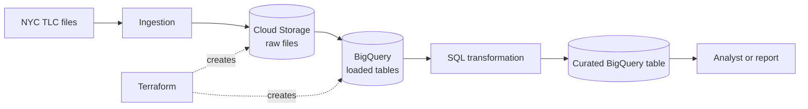

# Week 11 — Cloud platform and Terraform

[Module homepage](../../README.md) · [Downloads before class](../../preparation/week-11.md)

## Goal

Extend the NYC Taxi example from one local database to a small cloud data platform. By the end of the practical, you should be able to:

- distinguish a data lake, data warehouse, and data mart;
- explain the difference between ETL and ELT;
- distinguish infrastructure provisioning from a data pipeline;
- read and write a small Terraform configuration;
- inspect a Terraform plan before creating resources;
- provision a Google Cloud Storage bucket and BigQuery dataset; and
- publish and verify NYC Taxi data using those resources.

## From Week 5 to Week 11

In Week 5, Kestra coordinated tasks that downloaded, transformed, validated, and loaded taxi records into local PostgreSQL. Week 11 introduces cloud storage and a cloud analytical database.

The solid arrows show the **data pipeline**: data moves and changes. The dotted arrows show **infrastructure provisioning**: Terraform creates and configures the places where the data will live. Terraform does not replace ingestion or transformation.

## Planned practical sequence

1. [Map the local pipeline to a cloud platform](part-1-platform-map.md).
2. [Set up the Google Cloud project, billing and authentication](part-2-google-cloud-setup.md).
3. [Create a bucket and BigQuery dataset with Terraform](part-3-terraform.md): complete the starter, inspect plans, apply, and check state.
4. Refactor the configuration with variables and practise a controlled change.
5. Configure the pipeline identity and its access permissions.
6. Publish NYC Taxi data and verify it in BigQuery.
7. Change, inspect, and finally remove the infrastructure safely.

Parts 1–3 are available, including a Terraform starter. Refactoring, pipeline access and the subsequent pipeline activities will follow. Before class, complete only the [coupon activation and tool installations](../../preparation/week-11.md); project creation and authentication are classroom activities.

## Project connection

The final project requires Terraform-managed Google Cloud resources and an orchestrated source → Cloud Storage → BigQuery pipeline. This week establishes the project and infrastructure for that work.
