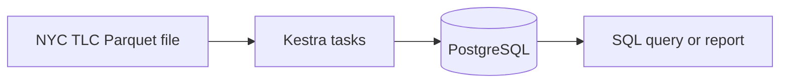
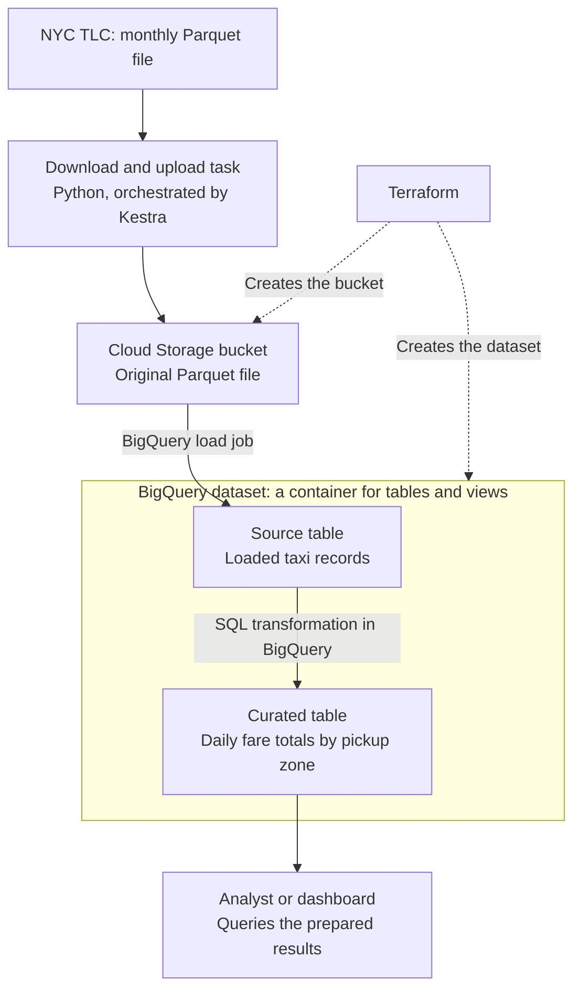

# Week 11 — Part 1: Map the local pipeline to a cloud platform

[Week 11 overview](README.md)

## Goal

Understand what each cloud component does before configuring it. This activity does not create resources or move data.

## 1. Start with the local pipeline

The Week 5 pipeline can be summarized as:

PostgreSQL holds both the loaded records and the tables queried by a consumer. This is suitable for the local exercise, but the final project also requires cloud object storage and a cloud warehouse.

## 2. Meet the cloud components

| Term | Meaning in this practical | NYC Taxi example |
|---|---|---|
| Data lake | Stores files in their original or lightly processed form. | Parquet files in a Google Cloud Storage bucket. |
| Data warehouse | Stores structured data for analytical SQL queries. | Tables in a BigQuery dataset. |
| Data mart | A focused, curated part of warehouse data for a particular consumer or topic. | A daily pickup-zone table for an analyst. |

A **Cloud Storage bucket** is a container for objects such as Parquet files. **BigQuery** is Google Cloud’s managed data warehouse: it stores analytical tables and executes SQL queries. In this design, it takes over the analytical role that PostgreSQL played in our local exercises. A **BigQuery dataset** is a namespace that groups BigQuery tables and views. The word `dataset` therefore has a specific BigQuery meaning here; it is not the taxi file itself.

## 3. Distinguish ETL and ELT

The letters describe when transformation happens:

| Pattern | Order | Example |
|---|---|---|
| ETL | Extract → Transform → Load | Python changes the taxi data before loading the result into PostgreSQL. |
| ELT | Extract → Load → Transform | Load source records into BigQuery, then use SQL in BigQuery to create a curated table. |

ELT does not mean that source data needs no validation or that every value should be exposed to every user. It means the main business transformation runs after data reaches the analytical platform.

## 4. How the cloud pipeline fits together

The diagram below shows the planned data path. You do not need to create these tables or write BigQuery SQL yet.

**Read the solid arrows from top to bottom:**

1. A pipeline task downloads a monthly taxi file from TLC and uploads it to Cloud Storage.
2. Cloud Storage retains the original file. It is file storage, not a table that we query in this example.
3. A BigQuery load job reads the file and creates or populates a source table. The records are now available for SQL queries.
4. SQL in BigQuery transforms those records into a curated table—for example, daily fare totals by pickup zone.
5. An analyst or dashboard queries that prepared table.

**The dotted arrows mean “creates the infrastructure.”** Terraform creates the bucket and the BigQuery dataset. Creating these containers does not download a file, load a table or calculate a report. Pipeline tasks perform those actions; Kestra can coordinate when they run and in which order.

**For this session:** we create the bucket and dataset with Terraform. Optional [Part 5](part-5-kestra-to-cloud-storage.md) uploads one file to the bucket. Loading it into BigQuery, transforming it and serving a report are later follow-up work. The complete diagram explains what those resources will be used for later.

## 5. Decide what Terraform should manage

Classify each action as **infrastructure** or **data pipeline**:

1. Create a Cloud Storage bucket.
2. Download a monthly taxi file.
3. Create a BigQuery dataset.
4. Upload a Parquet file.
5. Transform loaded records with SQL.
6. Configure the Google Cloud region for a dataset.
7. Validate that the curated table contains records.

Terraform will manage actions 1, 3, and 6 in this practical. The pipeline will perform actions 2, 4, 5, and 7. Keeping these responsibilities clear makes it easier to reason about failures: an empty bucket may mean provisioning succeeded while ingestion failed.

## Discuss

1. Why keep the source Parquet file after loading records into BigQuery?
2. If a SQL transformation is incorrect, which stored copy would let you create the curated table again?
3. Why should students inspect a Terraform plan before applying it?
4. Which part of this design supports a specific consumer: the raw bucket, the loaded source table, or the curated table?

**Key takeaway:** Cloud Storage retains files, BigQuery holds analytical tables and runs SQL, and Terraform creates the infrastructure that the pipeline will use.

[Next: set up your Google Cloud project](part-2-google-cloud-setup.md)
