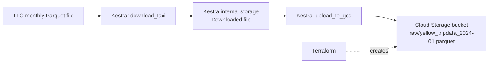

# Week 11 — Part 5: Upload a taxi file to Cloud Storage with Kestra

[Week 11 overview](README.md) · [Previous: Terraform variables](part-4-terraform-variables.md)

## Goal

Connect the local orchestrator to the bucket you created with Terraform. Complete two tasks: download one monthly taxi file, then upload it unchanged to Cloud Storage. **Terraform creates the bucket; Kestra puts data into it.**

Reuse the working local Kestra installation from Week 5. BigQuery loading and SQL transformation come later; the dataset stays empty in this exercise.



The second task receives the first task's file URI. It does not use a shared `data` folder or run the Week 5 ETL scripts.

## 1. Make sure the bucket exists

From the repository root:

```sh
cd weeks/11-cloud-platform-and-terraform/terraform
terraform plan
```

Keep the **Terraform service-account key** configured through `GOOGLE_APPLICATION_CREDENTIALS`, as in Part 2. If you completed `terraform destroy` in Part 3, the plan should propose recreating the bucket and dataset. Inspect it, run `terraform apply`, and confirm. If Part 4 already recreated the resources, no new apply is needed when the plan reports no changes.

Open **Cloud Storage → Buckets** in the correct project and record your bucket name. The flow needs the actual bucket name, not `raw_taxi`, which is only Terraform's resource name.

## 2. Give the pipeline access at project level

For this classroom exercise, grant access through the project, using the same approach as for the Terraform service account in Part 2. Use a separate account for Kestra: Terraform manages infrastructure, while Kestra works with files.

1. In the correct course project, open **IAM & Admin → Service Accounts → Create service account**.
2. Name it `kestra-week11` and select **Create and continue**.
3. In the step that grants the service account access to the project, select **Storage Object User** (`roles/storage.objectUser`).
4. Continue, leave the optional user-access step empty, and finish creation.
5. Open **IAM & Admin → IAM** and verify that the service account has **Storage Object User** in your course project.
6. Return to the service account. Under **Keys → Add key → Create new key**, download a JSON key.
7. Save it outside the repository, for example as `$HOME/.config/deng/keys/kestra-week11.json` on macOS/Linux or in the corresponding private folder under your Windows user profile.

**Project-level access applies to all buckets in this project, including buckets created later.** Storage Object User permits reading, creating, replacing and deleting objects. Replacement is needed for the rerun exercise. It does not grant permission to create buckets or BigQuery datasets. Use **Storage Object User**, not the Terraform account's administrator roles. [Google's upload permissions](https://docs.cloud.google.com/storage/docs/uploading-objects).

The **JSON key authenticates the service account**; the **IAM role grants access**. Downloading another key for the same account does not add permissions.

Keep both keys: **do not replace the Terraform key or change its terminal environment variable to the pipeline key**. The following setup supplies the pipeline key to Kestra separately. Never paste either key's contents into a flow, commit them to Git or show them in screenshots.

### Alternative: restrict access to one bucket using the service-account email

This is an alternative to the project-level setup above, not an additional required step. It is useful when the project contains other buckets the pipeline should not access.

A service account has an email-shaped identifier, for example:

```text
kestra-week11@YOUR_PROJECT_ID.iam.gserviceaccount.com
```

This identifies the account; no email is sent and no person is invited. In an IAM permissions screen, **principal** means the identity receiving access.

To grant access to one bucket instead:

1. Create the service account without a project role, or use the existing `kestra-week11` account.
2. Copy its email address from **IAM & Admin → Service Accounts**.
3. Open **Cloud Storage → Buckets → your bucket → Permissions → Grant access**.
4. Enter the service-account email as the principal, select **Storage Object User**, and save.
5. If the account already has Storage Object User at project level, remove that project-level grant under **IAM & Admin → IAM** to restrict its access. Adding a bucket-level grant does not cancel wider inherited permissions.

The same JSON key continues to identify the same account. You do not need to download another key just because you changed its permissions.

| Where the role is assigned | Scope of object access |
|---|---|
| Project — our classroom setup | All buckets in the project, including future buckets. |
| One bucket — alternative | Only that bucket, provided the account has no other broader grants. |

## 3. Make the key available inside the Kestra container

A path on your laptop is not automatically available inside a container. We provide a small [Compose extension](compose.gcp.yaml) that mounts the pipeline key read-only and sets the credential path **inside Kestra**.

Open your existing **`weeks/05-workflow-orchestration/.env`**. Keep its existing settings and add one line with the **absolute path to the pipeline JSON file**, not to its containing folder:

```dotenv
KESTRA_GCP_KEY_FILE=/Users/YOUR_USERNAME/.config/deng/keys/kestra-week11.json
```

On Windows, use your actual path with forward slashes, for example `C:/Users/YOUR_USERNAME/.config/deng/keys/kestra-week11.json`. Replace the example username. If the path contains spaces, surround its value with double quotes. The existing `.env` is ignored by Git.

Open a terminal at the **repository root**, then run:

```sh
cd weeks/05-workflow-orchestration
docker compose -f compose.yaml -f ../11-cloud-platform-and-terraform/compose.gcp.yaml up -d kestra
```

| Part of the command | Meaning |
|---|---|
| `-f compose.yaml` | Use the existing Week 5 services and settings. |
| `-f ../11-cloud-platform-and-terraform/compose.gcp.yaml` | Add the key mount and credential-path setting to the Kestra service. This is a Compose YAML file, not a Kestra flow. |
| `up -d kestra` | Apply the configuration to Kestra and start its dependencies if needed. Existing named volumes retain flow history and data. |

Do not run the extension file by itself. Continue using both `-f` options when recreating Kestra for this exercise; using only the base file would remove the added mount and environment setting.

Inside the container, the key is available at `/run/secrets/kestra-gcp.json`. The extension sets:

```yaml
environment:
  GOOGLE_APPLICATION_CREDENTIALS: /run/secrets/kestra-gcp.json
```

The Google client used by the upload plugin reads this file to authenticate. The JSON file remains outside Git. The host's Terraform credential setting remains separate. No `gcloud auth login`, new Python image or Docker build is needed.

Check that the mounted file is readable without displaying its contents:

```sh
docker compose -f compose.yaml -f ../11-cloud-platform-and-terraform/compose.gcp.yaml exec kestra sh -c 'test -r /run/secrets/kestra-gcp.json && echo "Pipeline key file is readable"'
```

This checks file access, not Google permissions. The upload will test those permissions.

## 4. Create the flow and inspect the first output

1. Open your existing Kestra UI, normally [localhost:8080](http://localhost:8080), and sign in with your Week 5 credentials.
2. Create a flow. Copy the entire [starter YAML](flows/01-taxi-to-gcs-starter.yaml) into the editor and save it.
3. Execute with your **bucket name**, year **2024**, month **01**. Enter the bucket name without `gs://`.
4. Open the execution's **Outputs**, select `download_taxi`, and inspect `uri`. It identifies the downloaded file in Kestra's internal storage.

**At this stage only the download task runs.** A successful execution does not mean anything has reached Cloud Storage yet. The file is a full monthly Parquet file, so allow time and local storage for the download.

## 5. Your turn: connect the upload task

In the same flow's editor, find the commented `upload_to_gcs` task. Uncomment its four lines, keeping it at the same indentation as `download_taxi`, and replace both TODO strings:

| Property | What you must supply |
|---|---|
| `from` | A Kestra expression referencing the `uri` output of `download_taxi`. Use the pattern `{{ outputs.TASK_ID.OUTPUT_NAME }}`. |
| `to` | A destination starting with `gs://`, followed by the bucket input and `raw/yellow_tripdata_YEAR-MONTH.parquet`, using the year and month inputs. |

For example, with bucket `my-course-taxi-raw`, year `2024` and month `01`, the destination should be:

```text
gs://my-course-taxi-raw/raw/yellow_tripdata_2024-01.parquet
```

`gs://` identifies a Cloud Storage object. `raw/` is part of the object's name; you do not need to create a folder first. The month input already contains its leading zero.

**Before running:** Explain why `from` must reference the downloaded file rather than the TLC URL. Which task runs first, and what happens to the upload if downloading fails?

Save your changes. Execute the updated flow with the same inputs. Both tasks should appear and finish successfully. These are built-in plugin tasks running in Kestra, so there is no `containerImage` or Docker `taskRunner` in the flow. Check that the editor recognizes `io.kestra.plugin.gcp.gcs.Upload`; if it reports an unknown task type, ask the instructor to check the installed GCP plugin for the course Kestra version before continuing.

## 6. Verify the upload and investigate a rerun

In **Cloud Storage → your bucket → Objects**:

1. Find `raw/yellow_tripdata_2024-01.parquet`.
2. Check that its size is greater than zero. Where available, compare it with the download task's reported length.
3. Open the object's details and record its generation and update time.

**Predict:** If you execute the same flow again with identical inputs, will it create a second object name, append taxi rows, or replace the object at the existing name?

Run it again, then compare the object listing and details. Explain what happened. Changing the year or month changes the destination name; rerunning the same month uses the same destination. Object Versioning or soft delete may retain earlier generations, so one visible live object does not necessarily mean only one stored version. This exercise is not row-level deduplication, and it does not validate the Parquet records.

**Discuss:** If TLC republishes a changed file at the same URL, would the same destination name preserve the original contents? What naming strategy could retain each downloaded version?

## 7. Finish and clean up

Keep the object only if the instructor asks you to continue with it. Otherwise, use the Console to delete **only the exercise object** you uploaded. If versioning is enabled, check for noncurrent versions too before trying to remove the bucket. Soft-deleted objects can remain billable until their retention expires; deleting a live object is not a promise of immediate removal of all retained copies.

Return to the original Terraform directory, keep the Terraform key configured, and use `terraform plan -destroy` followed by `terraform destroy` as in Part 3. Leave `force_destroy = false`; do not bypass the nonempty-bucket check. The project-level grant remains when the bucket is deleted, and a recreated bucket in the same project inherits it. If you chose the bucket-level alternative, grant access again after recreating the bucket. These manual IAM grants are not managed by this Terraform configuration.

The pipeline service account and key were created manually, so this Terraform configuration does not delete them. If they are no longer needed, delete the pipeline key under **IAM & Admin → Service Accounts → kestra-week11 → Keys**. Keep the separate Terraform key for later infrastructure exercises.

## If something fails

| Symptom | Check |
|---|---|
| Download fails with 404 | Check the selected year/month and whether TLC has published that file. Use January 2024 for the first run. |
| Missing `KESTRA_GCP_KEY_FILE` | Add its absolute path to the existing Week 5 `.env`, then run from the Week 5 directory. |
| Bind mount or credential-file error | Check that the host path points to the pipeline JSON file and Docker Desktop can access it. Recreate Kestra with both Compose files. |
| Upload fails with 403 | Verify the mounted key belongs to `kestra-week11`, and that this identity has Storage Object User in the project containing the destination bucket (or on that bucket if using the alternative). IAM changes can take time to propagate. |
| Bucket not found | Check the bucket input and recreate the Terraform-managed bucket if it was destroyed. |
| Download succeeds but no upload appears | Uncomment and complete the upload task, save, then start a new execution. |
| Cannot resolve an output expression | Check the task ID `download_taxi` and output name `uri`, and ensure the download task comes first. |

**Finish with:** a successful two-task execution and a matching object in Cloud Storage. Explain which identity created the bucket and which identity uploaded the file.

References: [Kestra GCS Upload](https://kestra.io/plugins/plugin-gcp/google-cloud-storage-gcs/io.kestra.plugin.gcp.gcs.upload) · [Google credential-file discovery](https://docs.cloud.google.com/docs/authentication/application-default-credentials) · [Cloud Storage upload permissions](https://docs.cloud.google.com/storage/docs/uploading-objects).
