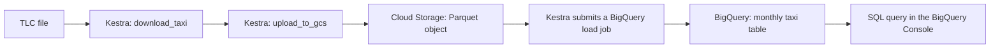
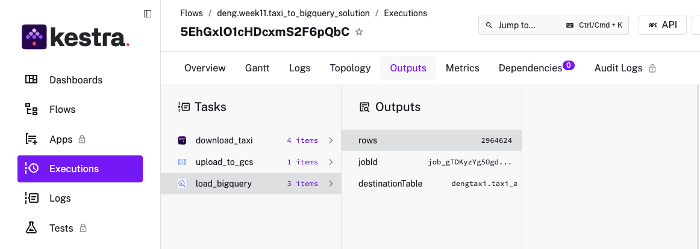

# Week 11 — Part 6: Load and query taxi data in BigQuery

[Week 11 overview](README.md) · [Previous: upload to Cloud Storage](part-5-kestra-to-cloud-storage.md)

## Goal

Extend the two-task flow from Part 5 with a third task that loads the Parquet file into BigQuery. Inspect the table, query its rows, and investigate what happens when the flow runs again.

This is an optional follow-up to the core Terraform session. **BigQuery is the database that stores the analytical table and executes SQL. Kestra submits the load job and waits for its result.**



Loading creates a regular BigQuery table containing the records; it is not an external table that reads the Parquet file for each query. The original object remains in Cloud Storage. Business transformations come later.

## 1. Continue from Part 5

You need:

- A working two-task flow from Part 5 and the same Kestra container with its pipeline key mounted.
- Your Terraform-created bucket and `taxi_analytics` dataset in the same course project.
- Both resources in **EU**, as configured in Part 3. The load job must use that dataset location.

If you already cleaned up, recreate the resources with the original Terraform configuration and state. If you deleted the pipeline key, create a replacement for `kestra-week11`, update its path, and recreate Kestra using both Compose files as explained in Part 5. Do not switch the host's Terraform credentials to the pipeline key.

Record the **project ID**, **bucket name**, **dataset ID**, and **dataset location**. A dataset groups tables; it does not yet contain taxi records merely because Terraform created it.

## 2. Add the pipeline's BigQuery permissions

Keep the existing `kestra-week11` service account and JSON key. Changing permissions does not require another key.

For this dedicated classroom project, use project-level grants as in Part 5:

1. Open **IAM & Admin → IAM** in your course project.
2. Find the `kestra-week11` service account and edit its roles.
3. Keep **Storage Object User**, then add the following roles and save:

| Additional role | Why it is needed |
|---|---|
| **BigQuery Job User** (`roles/bigquery.jobUser`) | Submit BigQuery jobs in this project. |
| **BigQuery Data Editor** (`roles/bigquery.dataEditor`) | Create and update the destination tables. At project level this applies across the project's datasets. |
| **Storage Bucket Viewer** (`roles/storage.bucketViewer`) | Read bucket metadata needed for the load, including `storage.buckets.get`. Part 5's object role provides access to file contents but does not include this bucket permission. |

The project-level Data Editor role is a classroom simplification. It can instead be granted on just `taxi_analytics`; Job User must still be granted on the project. We do not need to give Kestra BigQuery Admin or reuse the Terraform service account.


References: [BigQuery load requirements](https://docs.cloud.google.com/bigquery/docs/loading-data-cloud-storage-parquet) · [Cloud Storage roles](https://docs.cloud.google.com/storage/docs/access-control/iam-roles).

## 3. Create a new flow from the starter

Open [02-taxi-to-bigquery-starter.yaml](flows/02-taxi-to-bigquery-starter.yaml). Create a **new flow** in Kestra and paste the entire file into the editor. It uses `id: taxi_to_bigquery` and `namespace: deng.week11`, so your Part 5 flow remains available.

The download and upload tasks are complete. Your task is to finish the commented `load_bigquery` task. **Do not execute the incomplete starter expecting a BigQuery table:** until you enable the third task, success means only download and upload.

Uncomment the entire third task, keep it aligned with the other tasks, and complete its three TODO values:

| Property | What to work out |
|---|---|
| `from` | A list containing the Cloud Storage URI produced by `upload_to_gcs`. Use the pattern `{{ outputs.TASK_ID.OUTPUT_NAME }}` with output name `uri`. |
| `destinationTable` | Build `PROJECT.DATASET.yellow_trips_YEAR_MONTH` using the corresponding inputs. |
| `writeDisposition` | Choose the behaviour that replaces the selected month's table when rerunning. |

The remaining settings are provided:

- `projectId`: project where the job runs.
- `location`: dataset location, **EU** in our exercise.
- `format: PARQUET`: the uploaded file format; BigQuery reads the schema from the file.
- `createDisposition: CREATE_IF_NEEDED`: allow the load job to create the table if it does not exist. The dataset must already exist.

Use these choices to decide the rerun behaviour:

| Choice | When the destination table already contains rows |
|---|---|
| `WRITE_APPEND` | Add the file's rows to the existing rows. |
| `WRITE_TRUNCATE` | Replace the table's contents with the loaded data. |
| `WRITE_EMPTY` | Fail instead of writing into a nonempty table. |

For project `my-course-project`, dataset `taxi_analytics`, year `2024`, and month `01`, the destination should be:

```text
my-course-project.taxi_analytics.yellow_trips_2024_01
```

**Why include the month in the table name?** Replacing January's table should not erase February. This is a simple teaching design. Section 7 adds a shared table using a separate merge task; do not use one shared table with full-table replacement for all months.

## 4. Save and execute the completed flow

Save the edited **`taxi_to_bigquery` flow in Kestra**. Check that the editor recognizes `io.kestra.plugin.gcp.bigquery.LoadFromGcs` and accepts the configuration. Use the installed plugin's documentation if it differs from the latest online documentation; do not upgrade the course environment just to follow a newer example.

Execute with:

| Input | Value |
|---|---|
| `project_id` | Your course project ID, not its display name. |
| `dataset` | `taxi_analytics`, or your actual dataset ID if different. |
| `location` | `EU`, matching the existing dataset. |
| `bucket` | Your actual bucket name, without `gs://`. |
| `year` | `2024` |
| `month` | `01` |

Watch all **three tasks**. The load task should finish successfully. Inspect its outputs for the destination table, job ID and loaded row count where exposed by your installed plugin. A failure in loading does not undo the already completed upload.

Run one execution at a time for a given month; wait for it to finish before starting the rerun. Both executions would otherwise write to the same object and table.

The full flow downloads and uploads again on each execution. That is intentional here: it demonstrates the complete source → storage → table path.

## 5. Inspect and query the table

Open **BigQuery** in the Google Cloud Console. In Explorer, expand your project, then `taxi_analytics`, and select `yellow_trips_2024_01`. Refresh Explorer if necessary.

- **Schema:** inspect the column names and types. These are the original TLC fields, such as `tpep_pickup_datetime` and `fare_amount`; this flow did not rename them to the Week 5 ETL column names.
- **Preview:** look at a few records.
- **Details:** confirm the table exists in the expected dataset.

Open a SQL editor. Replace `YOUR_PROJECT_ID` below with your project ID, and adjust the dataset/table if you used other inputs. Keep the **backticks** around the full table name. Run each query separately.

Count the records:

```sql
SELECT COUNT(*) AS trip_count
FROM `YOUR_PROJECT_ID.taxi_analytics.yellow_trips_2024_01`;
```

Record the SQL count. In Kestra, open the completed execution, select **Outputs → load_bigquery**, and find **rows**. This is the number of rows reported by the BigQuery load job started by that task. Compare it with your SQL `COUNT(*)` result for the destination table.



The example above reports **2,964,624 loaded rows**. Your count depends on the source file you loaded. Also check **destinationTable** to confirm that the task loaded the intended table. Kestra **SUCCESS** alone does not establish this.

Inspect a few fields:

```sql
SELECT tpep_pickup_datetime,
       tpep_dropoff_datetime,
       trip_distance,
       fare_amount
FROM `YOUR_PROJECT_ID.taxi_analytics.yellow_trips_2024_01`
LIMIT 10;
```

BigQuery executes these queries in Google Cloud, not in local PostgreSQL or the Kestra container. Check the editor's estimated bytes processed before running; `LIMIT 10` limits returned rows, not necessarily the data scanned. For simply browsing records, use Preview.

## 6. Predict and test a rerun

Before rerunning, write down the current row count and predict the next count.

1. Execute the same saved flow again with the same project, dataset, bucket, year and month.
2. Wait until `load_bigquery` succeeds.
3. Run the count query again.
4. Explain whether your chosen `writeDisposition` produced the intended result.

With replacement and an unchanged source file, the count should stay the same. This avoids accumulating rows across identical reruns; it does **not** remove duplicate records already present in the source file. A changed source file can legitimately change the resulting table and count.

**Discuss:** What would happen with `WRITE_APPEND`? What would happen if February used exactly the same destination table name as January with `WRITE_TRUNCATE`?

A successful replacement updates the destination table as one load operation. It does not make the download, Cloud Storage upload and BigQuery load one shared transaction.

## 7. Add new months to one table without repeating rows

Now keep January, February and later months together in **`yellow_trips`**. Keep the existing three tasks: the monthly table becomes a **staging table**, where the file is loaded before its records are added to the shared table.

```text
Download → Upload → Load monthly staging table → Merge into yellow_trips
```

Simply changing the destination to `yellow_trips` with `WRITE_APPEND` would repeat every row on a rerun. Instead, use the hash idea from Week 2: compute a fingerprint of each source row and insert it only if that fingerprint is not already present.

### Add a fourth task

Create a new flow by copying your completed three-task YAML and changing its flow ID to **`taxi_to_bigquery_merge`**. Keep the monthly destination and `WRITE_TRUNCATE` in `load_bigquery`. Append the following fourth task under `tasks:`, aligned with the previous tasks:

```yaml
  - id: merge_trips
    type: io.kestra.plugin.gcp.bigquery.Query
    projectId: "{{ inputs.project_id }}"
    location: "{{ inputs.location }}"
    sql: |
      -- Prepare distinct rows and their content hashes for this month.
      CREATE TEMP TABLE incoming_trips AS
      SELECT DISTINCT
        TO_HEX(SHA256(TO_JSON_STRING(t))) AS row_hash,
        DATE('{{ inputs.year }}-{{ inputs.month }}-01') AS source_month,
        t.*
      FROM `{{ inputs.project_id }}.{{ inputs.dataset }}.yellow_trips_{{ inputs.year }}_{{ inputs.month }}` AS t;

      -- Create the shared table on the first run, with the same columns.
      CREATE TABLE IF NOT EXISTS `{{ inputs.project_id }}.{{ inputs.dataset }}.yellow_trips` AS
      SELECT * FROM incoming_trips WHERE FALSE;

      -- Add only rows whose hash is not already in the shared table.
      MERGE `{{ inputs.project_id }}.{{ inputs.dataset }}.yellow_trips` AS target
      USING incoming_trips AS source
      ON target.row_hash = source.row_hash
      WHEN NOT MATCHED THEN
        INSERT ROW;
```

Read the SQL in three parts:

1. **Prepare incoming rows:** `TO_JSON_STRING(t)` represents all original columns of a row as text. `SHA256` hashes that text; `TO_HEX` makes the hash readable. `SELECT DISTINCT` removes identical rows within this incoming file. `source_month` records the file's month, independently of the pickup timestamp.
2. **Create the shared table if needed:** `WHERE FALSE` copies the column structure without inserting rows. If `yellow_trips` already exists, this statement leaves it unchanged.
3. **Merge:** match incoming and stored rows by `row_hash`. `WHEN NOT MATCHED` inserts only unseen rows. There is no update or delete clause, so existing rows remain. `INSERT ROW` inserts all source columns in order; this example creates the destination with the same column order.

The hash uses the original source columns, **not** the execution date or `source_month`. An identical source row therefore has the same hash when the flow runs again. BigQuery executes this SQL; Kestra coordinates the tasks. The temporary `incoming_trips` table exists only for this SQL script.

### Test January, February and a rerun

Use **2024-01 and 2024-02** for this exercise, with their matching source schemas. Run **one execution at a time**, including across copies of this flow: this example does not implement a lock or an enforced unique constraint for concurrent writers. Start with a new `yellow_trips` table created by this task, not a table previously filled using plain append.

1. Save and execute the new four-task flow for **2024 / 01**. Wait for `merge_trips` to succeed.
2. Run the following query and record January's count.
3. Execute for **2024 / 02**. Query again: February should appear and January's count should remain unchanged.
4. Execute **2024 / 01 again**, with the same source file. Both counts should remain unchanged.

```sql
SELECT source_month, COUNT(*) AS trip_count
FROM `YOUR_PROJECT_ID.taxi_analytics.yellow_trips`
GROUP BY source_month
ORDER BY source_month;
```

Check for repeated hashes. This query should return **no rows**:

```sql
SELECT row_hash, COUNT(*) AS copies
FROM `YOUR_PROJECT_ID.taxi_analytics.yellow_trips`
GROUP BY row_hash
HAVING COUNT(*) > 1;
```

The shared table's count can be smaller than the staging count because identical source rows are collapsed. If the same row occurs in two files, it is stored once, with the `source_month` of the first file processed.

**Discuss:** Why do we need both `SELECT DISTINCT` and `MERGE`? What would happen if a republished record had a corrected fare?

**Scope of this duplicate rule:** identical source records count as duplicates; a hash is not a true trip identifier. Two genuine trips with identical recorded values would be collapsed. A changed fare produces a different hash and is inserted as another record; this insert-only design does not reconcile corrections or deletions. Hash collisions are theoretically possible. Changing the source schema or column order also requires reviewing the hash definition and destination schema before loading further years.

References: [Kestra BigQuery Query](https://kestra.io/plugins/plugin-gcp/google-cloud-bigquery/io.kestra.plugin.gcp.bigquery.query) · [BigQuery MERGE](https://docs.cloud.google.com/bigquery/docs/reference/standard-sql/dml-syntax#merge_statement) · [SHA256](https://docs.cloud.google.com/bigquery/docs/reference/standard-sql/hash_functions#sha256).

## 8. Finish and clean up

If continuing to a later SQL exercise, keep the resources as directed by the instructor. Otherwise:

1. In BigQuery, delete only the monthly exercise staging tables you created and, if you completed section 7, the shared `yellow_trips` table.
2. In Cloud Storage, delete only the uploaded exercise object(s), following Part 5's notes on versions and soft deletion.
3. Return to your original Terraform directory. With the Terraform key configured, inspect `terraform plan -destroy` and run `terraform destroy` to remove the now-empty dataset and bucket.

The tables were created by the load job, not recorded as separate Terraform resources. Do not enable `delete_contents_on_destroy` or `force_destroy` just to bypass cleanup checks. The manually granted IAM roles and service account remain after destroying the bucket and dataset; remove the pipeline key when it is no longer needed, as described in Part 5.

## If something fails

| Symptom | Check |
|---|---|
| Missing `bigquery.jobs.create` | Grant BigQuery Job User to the pipeline account in the job's project. |
| Table creation or write denied | Check BigQuery Data Editor for the pipeline account and the target dataset/project. |
| Missing `storage.buckets.get` | Check Storage Bucket Viewer; Storage Object User alone does not provide bucket metadata access. |
| Cannot read the source object | Inspect the successful upload output, bucket name, object path and pipeline account's Storage permissions. |
| Dataset not found / location mismatch | Verify the project ID, dataset ID and dataset location. This practical uses EU for both bucket and dataset. |
| Flow succeeds but no table appears | Confirm the third task is uncommented, saved and executed; inspect its destination and the Console's selected project. |
| Row count increases unexpectedly on rerun | Check `writeDisposition`, the destination table name and whether the source file changed. |
| Old column names fail in SQL | Inspect Schema; this load retains TLC names rather than the renamed Week 5 ETL fields. |

**Finish with:** a successful load and a queryable BigQuery table. After section 7, also show a four-task execution, January and February in `yellow_trips`, and unchanged counts after a January rerun.

References: [Kestra LoadFromGcs](https://kestra.io/plugins/plugin-gcp/google-cloud-bigquery/io.kestra.plugin.gcp.bigquery.loadfromgcs) · [Loading Parquet into BigQuery](https://docs.cloud.google.com/bigquery/docs/loading-data-cloud-storage-parquet).
